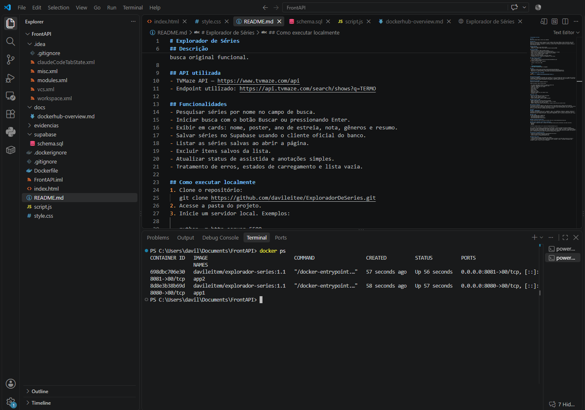

# Explorador de Séries

## Autor
Davi Leite Macedo Maduro — Matrícula 22553233

## Descrição
Aplicação frontend que permite pesquisar séries usando a API pública TVMaze e exibe informações como nome, poster, ano de estreia, nota, gêneros e resumo. A versão atual também permite salvar séries em um banco PostgreSQL com Supabase, visualizar a lista salva, excluir itens e registrar observações simples, mantendo a busca original funcional.

## API utilizada
- TVMaze API — https://www.tvmaze.com/api
- Endpoint utilizado: https://api.tvmaze.com/search/shows?q=TERMO

## Funcionalidades
- Pesquisar séries por nome no campo de busca.
- Iniciar busca com o botão Buscar ou pressionando Enter.
- Exibir em cards: nome, poster, ano de estreia, nota, gêneros e resumo.
- Salvar séries no Supabase usando o cliente oficial do banco.
- Listar as séries salvas ao abrir a página.
- Excluir itens salvos da lista.
- Atualizar status de assistida e anotações simples.
- Tratamento de erros, estados de carregamento e lista vazia.

## Como executar localmente
1. Clone o repositório:
   git clone https://github.com/davileitee/ExploradorDeSeries.git
2. Acesse a pasta do projeto.
3. Inicie um servidor local. Exemplos:

   python -m http.server 5500

   ou

   npx http-server -p 5500
4. Abra http://localhost:5500 no navegador.

## Links
- Repositório GitHub: https://github.com/davileitee/ExploradorDeSeries
- Aplicação no ar (GitHub Pages): https://davileitee.github.io/ExploradorDeSeries/
- Repositório no Docker Hub: https://hub.docker.com/r/davileitem/explorador-series

## Comando Docker para o avaliador
```bash
docker run -d -p 8080:80 davileitem/explorador-series:1.1
```

## Persistência de dados
O projeto usa Supabase com PostgreSQL para armazenar as séries escolhidas pelo usuário. Os dados não ficam em localStorage e continuam disponíveis mesmo após fechar o navegador. A URL do projeto e a chave anon pública do Supabase já estão configuradas no topo do arquivo script.js; a chave anon é pública por design e própria para uso no frontend.

### Estrutura da tabela
Arquivo de referência: supabase/schema.sql

Tabela principal: public.series_salvas

- id: bigint generated by default as identity primary key
- criado_em: timestamptz not null default now()
- tvmaze_id: integer not null unique
- nome: text not null
- ano_estreia: text
- nota: numeric
- generos: text
- poster_url: text
- dados_extra: jsonb
- assistida: boolean not null default false
- anotacao: text

### O que é salvo
- ID da série da TVMaze para evitar duplicatas
- Nome, ano, nota, gêneros e poster
- Resumo e demais campos extras em JSON
- Status de assistida e anotação textual opcional

### Como funciona o CRUD
- CREATE: botão Salvar em cada cartão de resultado
- READ: seção Minhas séries salvas carregada ao abrir a página
- DELETE: botão Excluir em cada item salvo
- UPDATE: checkbox para marcar como assistida e campo de anotação para escrever texto

### Limitação conhecida
As políticas de linha de segurança (Row Level Security) foram abertas para o papel anon para permitir funcionamento direto no frontend sem autenticação. Isso significa que qualquer pessoa com a chave anon pública pode ler e gravar dados nesta tabela. Em produção, a prática correta seria autenticar usuários e aplicar políticas por usuário/role, evitando acesso indiscriminado.

## Docker
### SQ1 — .dockerignore
O arquivo .dockerignore exclui .git, .gitignore, .idea, *.iml, README.md, evidencias, supabase, Dockerfile e .dockerignore do contexto de build. Isso reduz o tamanho da imagem, acelera o build e evita enviar arquivos desnecessários para o daemon do Docker, o que deixa a imagem mais leve e o processo de publicação mais rápido.

### SQ2 — tags
As tags aplicadas para a imagem são:
- davileitem/explorador-series:1.0
- davileitem/explorador-series:1.1
- davileitem/explorador-series:latest

As três tags aparecem em: https://hub.docker.com/r/davileitem/explorador-series/tags

### SQ3 — overview do Docker Hub
O Overview do repositório no Docker Hub já está preenchido, com a descrição da aplicação, o comando docker run pronto para copiar e o link do repositório GitHub. O texto usado está salvo em docs/dockerhub-overview.md.

### SQ4 — dois containers simultâneos e evidências
Para validar a execução, a imagem publicada foi executada em dois containers ao mesmo tempo, com nomes e portas diferentes:

bash
docker run -d -p 8080:80 --name app1 davileitem/explorador-series:1.1
docker run -d -p 8081:80 --name app2 davileitem/explorador-series:1.1
docker ps


Print do docker ps mostrando app1 (porta 8080) e app2 (porta 8081) em execução:



Se eu tivesse 100 containers, eu gerenciaria com Kubernetes: criaria um cluster com nós de trabalho, distribuiria os pods em Deployments/ReplicaSets para manter réplicas desejadas, configuraria escalonamento horizontal com HPA e monitoramento para ajustar capacidade conforme a carga. Além disso, o Kubernetes recupera falhas automaticamente reiniciando pods, redistribuindo cargas e permitindo atualização gradual sem downtime, o que é a forma mais robusta de operar centenas de containers em produção.

## Evidências e documentação extra
- Arquivo do overview do Docker Hub: docs/dockerhub-overview.md
- Arquivo do SQL do banco: supabase/schema.sql
- Print do docker ps com dois containers: evidencias/docker-ps.png

## Observações finais
- A busca original continua funcionando com a TVMaze.
- A persistência em Supabase usa a URL do projeto e a chave anon pública já configuradas no script.js.
- O projeto é estático e não cria servidor próprio para o backend; o banco é acessado diretamente pelo navegador usando o cliente oficial do Supabase.
